# 最终研究报告

2026-11-18：Phase 00—13按上述实际范围完成研究原型与最终审计；106项测试通过、44条既有弃用警告，pip check无冲突。南山已完成全图用户均衡、24小时/97端点韧性与固定2000辆计划的SUMO抽样；关键性、治理及十种子实验使用三个TAZ的小型真实区域。尚未实施南山全尺度优化，不能宣称全区治理收益或已校准历史灾害预测。

## 暴雨内涝交通网络韧性评估与优化

研究报告与阶段进展 · 2026年11月18日。基于深圳南山真实有向道路网络，完成参数化内涝、静态用户均衡、全过程韧性、道路治理与SUMO原型。

治理与十种子实验使用独立小网压力情景，南山完成全图分配、97端点韧性和抽样SUMO。全部OD、容量、灾害峰值、成本与治理效果尚未标定。

## 研究范围与数据来源

南山研究窗口：20,447节点、40,105条有向边、33弱分量；小网1,140节点、2,247条有向边。保留方向、平行边和断连，不补造道路。范围是OSM行政边界与研究bbox交集，包含海域/岛屿，不等于官方陆地边界。

WorldPop 2020原生约1km像元分配后保留1,540,614.3657模型人数。568个TAZ中236个正产生/吸引区；193个区内有接入、43个缺接入但需求保留。人口年份与2026 OSM不一致。

Copernicus为DSM，非排水DTM；宝安机场逐日雨量只作区域背景，不拆成15分钟实测雨量。OSM有14医院、15消防站，入口待核验，完整避难所清单缺失。

## 监测水位证据与模型边界

45站18,123条水位样本，实际CSV覆盖2023-09-07 00:00:33至09-08 20:04:05。用户提供字段说明支持SW单位m、SJ北京时间；说明书截至19:40与实际记录冲突，以记录为准。来源为深圳市政府数据开放平台，水位资源29200/01403147，测站资源29200/01400987。

SW零点未由平台正式说明。旱时近零支持路面积水解释，但不能直接证明；因此观测SW未自动作为道路水深输入。坐标来自地址经高德编码和GCJ02转换，非官方传感器实测点。9281292012的说明书“沙井路近似定位”与CSV东莞POI方式不一致，保留位置警告。

0.15/0.30/0.40m蓝黄橙红为用户确认的源数据分级；本项目0.30m道路中断另属研究假设。说明书引用标准未提供核实条款，不作强制封路依据。

## 交通分配模型与基准验证

使用BPR：t=t0[1+0.15(x/c)^4]，AON按起点聚合，Frank–Wolfe配合方向导数线搜索。最短路每次选择当前成本最低的平行弧，原始弧流量独立保留；关闭边移出通行网络。Sioux Falls时间0.01小时乘36转秒，流量保留原基准单位。

Sioux Falls相对间隙9.9264538e-05，参考流量相对RMSE 0.0574%。南山平峰间隙1.704152e-05，节点守恒最大误差2.27e-12 veh/h。

南山平峰需求36,974.7448 veh/h：路网上服务31,971.5188、不可达3,649.7494、区内未上图1,353.4766。不可达与区内需求单列，不通过删OD提高结果。时片均衡不等于完整动态交通分配。

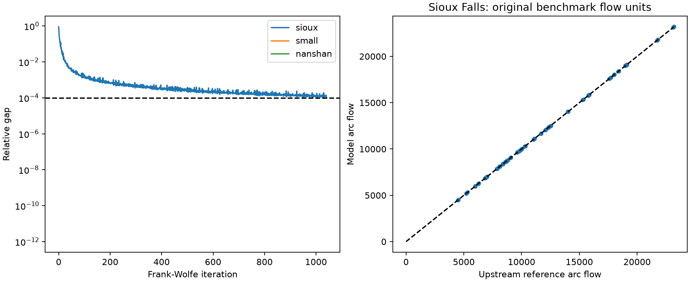

## 24小时参数化内涝情景

97端点、96个15分钟区间。地面几何匹配后的54条有向边使用h_e(t)=H_e g_e(t)，平滑增长和有限时间消退；空间相关长度1500m，基准峰值0.25m，峰时9h、增长4h、消退9h，延迟标准差0.5h。一般/严重/极端乘数0.65/1.25/2.0。

正常全零，三种灾害最大深度分别0.259、0.497、0.796m。完整Parquet、关键地图和每小时帧GIF均归档。本模型不是水动力预测，也未复现2023历史暴雨。

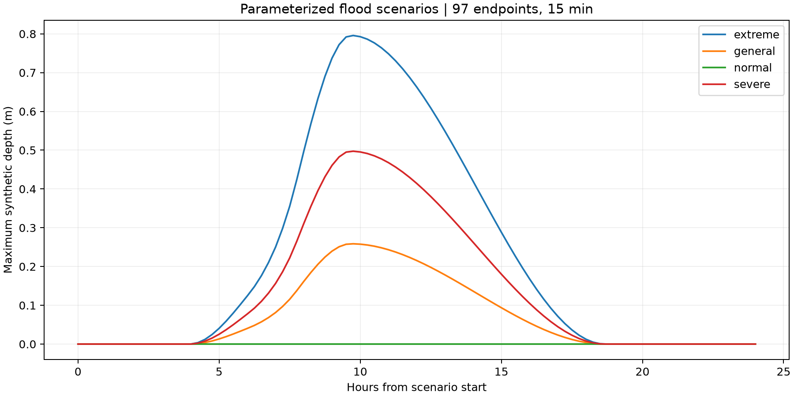

## 道路速度与容量退化

Pregnolato等（2017）PDF第7页Eq.4：v=0.0009w²−0.5529w+86.9448，w:mm、v:km/h。工程适配：零水深返回正常速度；速度不超过原自由流值；h≥0.30m排除通行。

容量独立设置为c0×max(0.2,1−0.8h/0.30)，达到中断阈值后移出网络。线性速度函数作对照，容量模型是项目假设，不能归为原论文结论。正常/轻度/重度/中断的边界为0、0.15、0.30m。

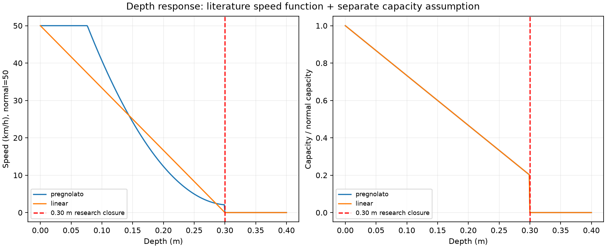

## 综合韧性的定义与成本口径

Qs为道路可用比例、最大弱/强连通节点比例、时间加权网络效率相对正常值的等权均值。效率不可达贡献0，南山15个固定起点到全部节点抽样；不声称是全节点对精确效率。

性能成本C=Σx_e t_e+300D_intrazonal+ρD_unserved，ρ默认14,400s。Qp=C0/C，同时间片、同OD正常基准。Qf对医院和消防15/30min人口覆盖比值取均值；缺失设施类别不补造，基准覆盖0项从归一化中排除并记录。

Q=0.2Qs+0.5Qp+0.3Qf；功能不可用时对有效权重重归一化。R按端点梯形积分除24h。需求率按7—10h早峰、17—20h晚峰，其余平峰；96区间计算车辆数，不将97端点视为97次发车。

## 南山全过程韧性结果

四个情景使用完全相同的小时OD与正常基准。正常、一般、严重、极端R依次为 1.000000000 / 0.999913959 / 0.999664636 / 0.999460725。

180次实际分配，最大gap 9.5e-05，节点守恒误差≤4.55e-12 veh/h；本次计算约21.6分钟。

影响较小是这组有限合成风险、合成OD与归一化口径的计算结果，不代表深圳真实暴雨损失很小。ρ=7200/14400/28800s时平均R约0.999523/0.999680/0.999792，既有未服务需求会影响归一化。

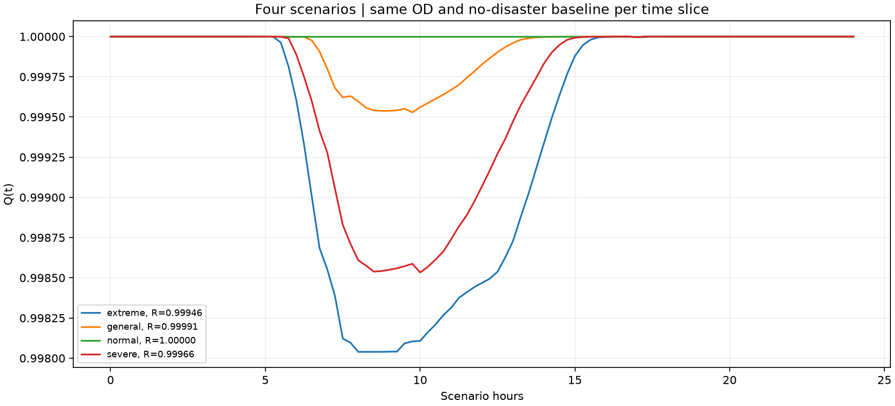

## 医院与消防设施可达性

居民起点来自TAZ人口与现有道路接入节点；无接入人口保留在分母中。设施代表点匹配至现有节点，最长1500m、虚拟接入速度20km/h，入口和实际接入路线未核验。沿有向交通时间找最近医院或消防站，未取得避难所清单。

地图为归档极端情景的代表时刻，展示60分钟截断色标，不可达原值保留在数据中。深色区域包含正常断连和接入缺失，不能直接归因于积水。小网所选TAZ人口约64,440.75，不能视为小bbox内精确人口。

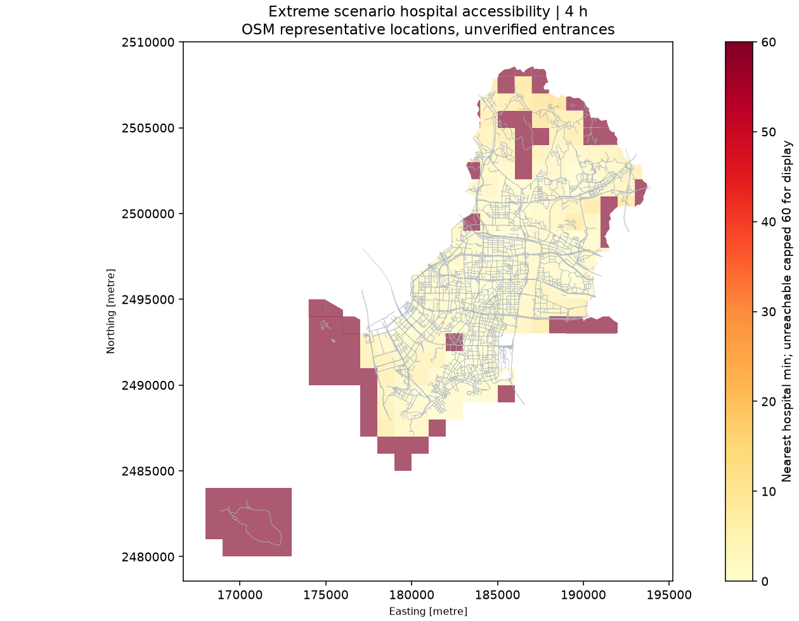

## 六组候选道路的关键性

小网使用独立压力情景：从正常有流量的现有地面物理几何组抽取六组，正反向弧共同治理。该风险设计有条件抽样偏差，与南山54弧风险集不同，不能混用。

实际计算峰值水深、正常流量、32起点抽样边介数、单独关闭性能损失、医院15分钟损失、逐路治理后重新分配的ΔR。当前六候选医院损失均为0，不制造功能增益。

单路治理最高ΔR约0.004171（road_05）。水深与ΔR的Spearman相关−0.20、正常流量与ΔR约0.93；仅六组样本，不据此作一般因果推断。

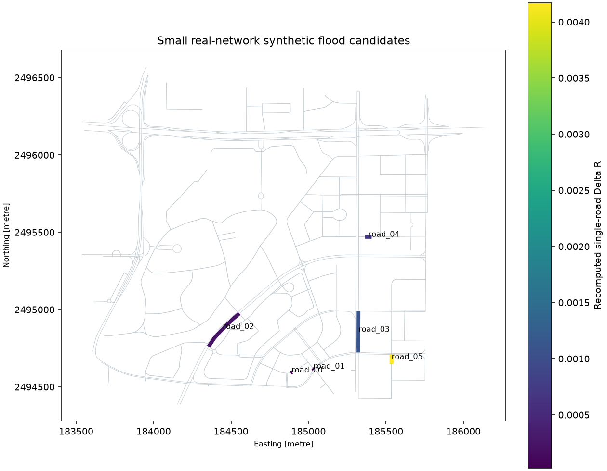

## 预算约束优化与穷举核验

统一成本1，预算3、K=3、积水削减0.6；一般/严重/极端等权作为研究设定，不是灾害真实概率。贪心每轮枚举可行新增道路，重新分配并以边际R/成本选择；没有正收益时停止，不要求花完预算。

种子42下，不治理R=0.991268226；韧性贪心选择road_05、road_03、road_04，R=0.997156009，提升约0.005887783。流量优先得到同一集合和数值。枚举42个可行集合，最优R相同，贪心差距0；这不是一般最优性保证。

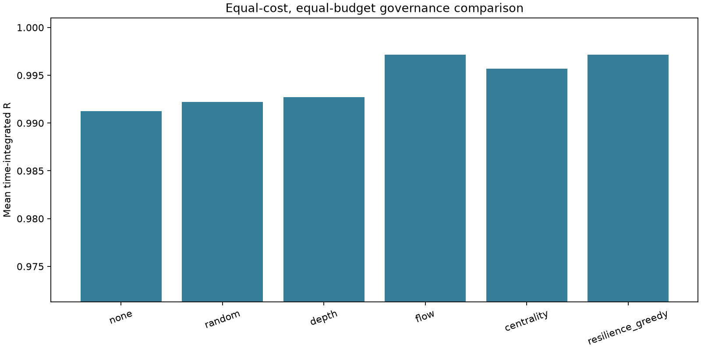

## 十种子策略与独立鲁棒性

训练种子42—51改变空间相关水深场；随机策略同种子取样。十种子平均R：不治理0.989540、随机0.993249、水深0.992793、介数0.994357、流量与贪心均0.996364。未人为要求贪心超过所有基准。

固定种子42学得的方案，在独立灾害种子1042—1051与OD种子5042—5051上评估。配对ΔR均值0.007565，95% t区间[0.006975,0.008156]。

区间只描述随机模型实现差异，不是深圳真实韧性参数置信区间。优化与测试保留相同评价公式；独立OD变化仅用于样本外检验。

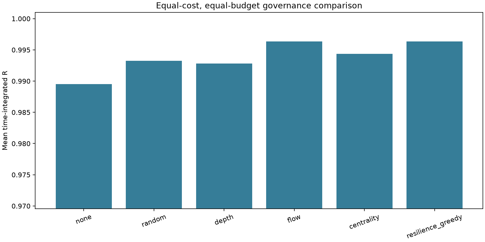

## 预算、效果与消融实验

预算请求K=0/1/3/5/10/20，六个候选不足时截断为0/1/3/5/6/6；效果δ=0.2/0.4/0.6/0.8。C/D为种子42的单因素敏感性，未给不存在的重复样本置信区间。

E分别替换动态积水为峰值常量、取消容量退化、固定正常路线（阻断OD计未服务）、取消功能权重，以及仅按严重情景优化后用多情景评价。无重新分配消融只在小网AON正常分配已均衡的范围使用，不能推广成对任意UE路流的精确路径分解。

G记录Sioux Falls、小网、南山的实际分配耗时与范围。南山全过程韧性约21.6分钟，候选优化与十种子只在小网运行，尚无南山全尺度优化耗时。

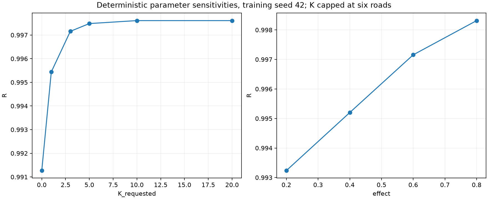

## SUMO车辆过程与完整去向

官方Eclipse SUMO 1.28.0已在项目环境运行。将真实OSM有向几何导出plain XML，保留edge_id映射；两个原有自环沿同一曲线分成两段以适配SUMO，不添加跨路连接。车道连接与路口优先规则由SUMO生成，信号、转向限制与跟驰未实测标定。

小网固定计划1890辆：1267有可行路线、623区内未上图。三情景均1263完成、4辆期末在途；完成者平均行程约231.00/245.94/234.77秒。设置time-to-teleport=-1，封路时保留在途车辆，无法发车的计划留外部队列，重规划失败保留原车。

南山固定抽样2000辆，约占全小时率积分0.184%；1723路由、277未路由计划，三情景均1708完成、15在途。小网治理集合与南山风险无交集，南山disaster/optimized相同，不能用来宣称全区治理收益。全部六运行车辆平衡且teleport为0。

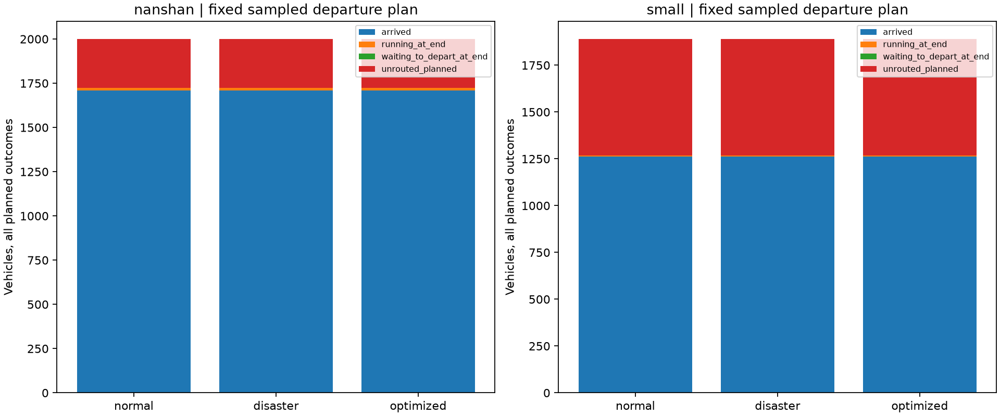

## 实际仿真车辆状态

图中位置来自SUMO TraCI实际车辆快照，非论文示意图。速度与通行限制每15分钟更新，SUMO内部步长1秒；BPR的veh/h容量不直接赋给SUMO容量。

小网治理验证具有模型条件依赖，南山采用抽样车辆只能检验转换、封路、绕行和记账链路，不能证明全量拥堵或城市级治理收益。未完成车辆与外部等待均在原始结果中保留。

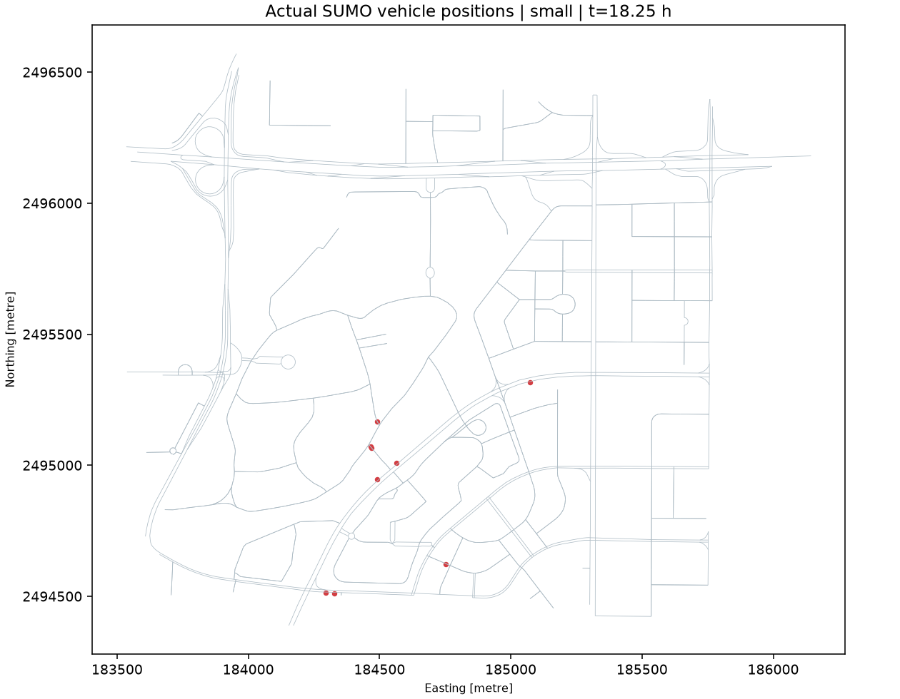

## 中文交互系统与历史查询

八页包括路网、内涝、道路状态、韧性、应急设施、关键道路、治理和算法实验。提供情景、15分钟时间轴、K、策略和治理效果筛选，治理前后选中道路图与CSV导出；明确展示预计算历史结果。

未计算的预算×策略×效果组合提示缺少结果，不伪装实时优化。8页经真实浏览器检查；CSV下载核验成功，截图保存在docs/validation/phase12。启动命令见项目说明书。

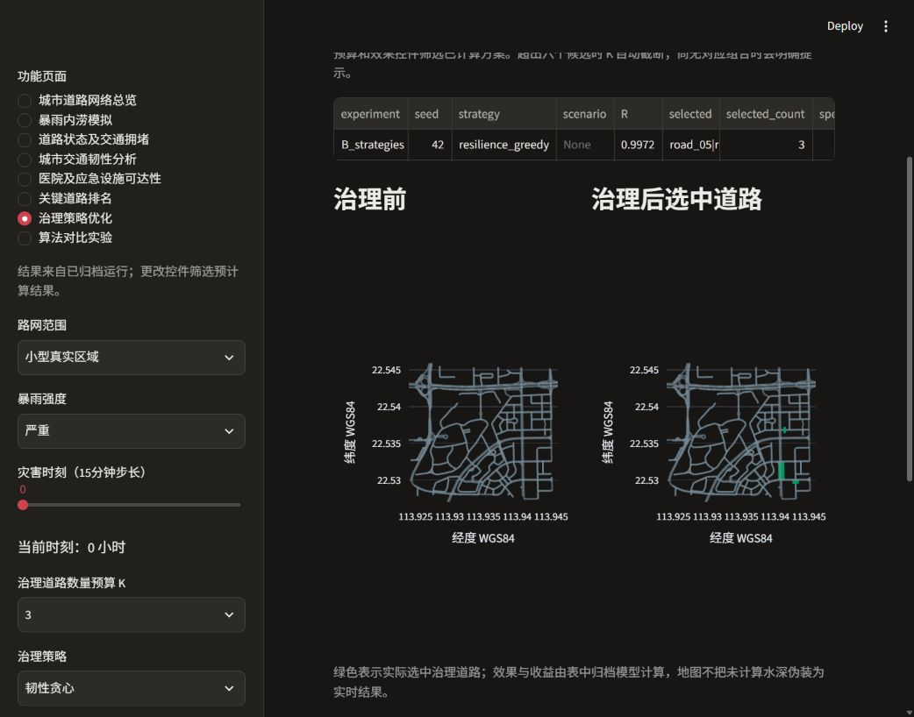

## 科学解释与规划使用边界

在当前小网压力设计中，选择网络替代性弱且正常承载较高的道路可改善平均韧性；最深积水优先并未取得最佳结果。这提示后续排水改造排序应同时检查交通需求和替代路线，而不能只按水深。

该结论不能直接变成深圳工程投资顺序：OD、速度/容量、治理成本效果、洪水概率、SW零点和地址位置尚未标定；人口、道路和事件年份不一致，完整避难所缺失。

下一轮实证工作应核实监测传感器位置与零点，取得实测路段速度流量、OD和信号数据，用独立事件校验暴露与性能，再扩大候选和优化范围。当前未完成南山全尺度优化，GA作为可选对照未实现。

## 验收、复现与成果位置

106项pytest通过，44条既有rasterio/affine弃用警告；pip check无冲突。检查正常/中断、平行弧、节点守恒、预算、穷举差距、独立种子、车辆去向和图片输入指纹。历史源文件按当前字节、原Git blob或SHA256完全一致的源快照核验，不改原运行。

每次运行独立run_id，保留失败和检查点；results/index.html为本机图片索引。所有原始结果留results/runs，data/raw与data/synthetic分开；GitHub保留源码、配置、维护文档与小型验收图片/表格。

本机启动：.conda-env\python.exe -m streamlit run app.py。阶段运行：.conda-env\python.exe -m uftr.cli run --phase 04（替换阶段号）；完整新实验使用configs/phase11_fresh.yaml，恢复检查点使用phase11.yaml。GitHub：https://github.com/zhzhzh666/jiaotong。

## 参考文献与数据许可

Pregnolato M, Ford A, Wilkinson S M, Dawson R J. The impact of flooding on road transport: A depth-disruption function. Transportation Research Part D, 2017, 55: 67–81. DOI 10.1016/j.trd.2017.06.020；采用边界：水深—速度函数；水深单位 mm，速度单位 km/h；容量退化另设。

Ma F, Ao Y, Wang X, et al. Assessing and enhancing urban road network resilience under rainstorm waterlogging disasters. Transportation Research Part D, 2023, 123: 103928. DOI 10.1016/j.trd.2023.103928；采用边界：SWMM 与 GIS、路段和节点性能；韧性损失面积越小越好。

He K, Pregnolato M, Carhart N, Neal J, De Risi R. Functionality assessment of road network combining flood roadworthiness and graph topology. Transportation Research Part D, 2024, 135: 104354. DOI 10.1016/j.trd.2024.104354；采用边界：同时考虑流速、水深与车型；Capacity 指车辆抗洪阈值。

Hong Y, Zhang Z, Fang X, Lu L. Evaluating the Dynamic Comprehensive Resilience of Urban Road Network: A Case Study of Rainstorm in Xi’an, China. Land, 2024, 13(11): 1894. DOI 10.3390/land13111894；采用边界：SUMO 与三维韧性；15 cm 中断、8分钟医疗可达性不能直接替换本项目参数。

靳超，王园园，李晨溪，李娟．典型设计暴雨下深圳市内涝空间分异与承灾体风险评估．热带地理，2026，46(3)：471—482． DOI 10.13284/j.cnki.rddl.20250873；采用边界：深圳水动力风险研究；作者5 m DEM和183个积水点尚未取得。

OpenStreetMap contributors，ODbL 1.0；WorldPop 2020，CC BY 4.0；Copernicus DSM保留供应商署名。Sioux Falls上游学术研究单位与版本见Phase01报告。深圳公开平台目录链接见DATA_SOURCES.md，字段说明为用户提供的研究数据字典，不冒充平台官方零点声明。

## 最终审计

运行20261118T005701_p13_457497bb，测试106，数据文件54，数值重放误差0。见validation/final_audit.json。

## 2026-11-18补充：南山合成输入数据

以下三节为新增实验输入，不替换前述Phase04—13结果；未按新包重跑交通评估。

### 补充情景 降雨驱动的合成积水

新增数据包采用固定种子42，在24小时内按15分钟步长生成降雨与积水。正常、一般、严重、极端情景总雨量分别为0、100、200、300 mm，名称仅表示实验强度，不对应官方重现期。

60个候选点沿用低DSM道路种子及高斯聚集。各点使用独立蓄水桶，有效降雨按假设汇水比例集中，并按假设排水能力与储量消退。水量守恒只验证计算一致，不能替代管网和水动力标定。

最高合成点水深为一般0.215 m、严重0.453 m、极端0.691 m。观测SW数据不参与本模型的零点或参数校准。

图片：`data/synthetic/scenario_packages/20261118T141443_nanshan_seed42/figures/synthetic_rainfall_depth.png`。

### 补充情景 南山合成积水点

所有60个合成候选点均在研究边界内。点位来源为既有低DSM道路种子及聚集，DSM含建筑植被，不能视为裸地排水地形。各点峰值可能发生在不同时间。

55点存在几何道路匹配，关联54条有向边；其余5点保留且不赋路段水深。路段使用关联点最大值，未列路段默认干燥仅为模型假设。几何匹配不能证明实际道路受淹。

本补充仅生成新实验输入，没有重跑既有交通分配、韧性或治理优化，原阶段实验结论不自动适用于这套新情景。

图片：`data/synthetic/scenario_packages/20261118T141443_nanshan_seed42/figures/synthetic_flood_points_map.png`。

### 补充情景 完整OD矩阵与出发需求

完整矩阵574×574，包含568个内部交通分区和6个外部网关。每个基准时段58528个非零OD对，242个ID有正需求，零需求区、不可达需求和区内需求均保留。OD沿用人口与设施生成的重力/IPF结果，未经实测校准。

平峰、早峰、晚峰小时总率分别为36974.7448、73949.4896、66554.5406 veh/h。按假设时间分布形成96个15分钟矩阵，全天期望出行量793108.28车次。区间矩阵单位为期望车次，小时率应除以0.25。

完整数据、配置、脚本及16项算术与回读检查存于data/synthetic/scenario_packages/20261118T141443_nanshan_seed42。所有天气情景使用相同外生OD，不推定真实雨天出行抑制或真实路段流量。

图片：`data/synthetic/scenario_packages/20261118T141443_nanshan_seed42/figures/synthetic_OD_demand.png`。

16项生成一致性检查、10输入/38输出指纹与ZIP成员核验通过；Word22页/PPT22张同步完成，7条原生图表序列与CSV核对。此前106项核心测试未在本次文档更新中重跑。

## 暴雨内涝全过程补充

### 情景建模 降雨与积水全过程

在已冻结南山合成数据上新增可复用的降雨蓄水与退水模块。以15分钟步长复算60点，参考雨量0/100/200/300 mm；5—13小时降雨，8和10小时附近双峰。实验强度与参数未经实测标定。

以mm计储量H，区间有效雨输入I=R×径流系数×假设汇水与积水面积比；排水D=min(H+I,c×Δt+H×Δt/τ)，H_next=H+I-D。基准τ=4小时，输出水深为H/1000 m。各点独立，不解析管网和水交换。

基准一般/严重/极端峰值为0.215/0.453/0.691 m，均在10.5小时出现。深度>0.15 m的单点最长持续时间分别为4.21/7.45/9.22小时；图中点数只针对60个合成候选点。

源图：`data/synthetic/storm_process/20261118T150315_storm_process_7b2a75f3/figures/storm_process.png`。

### 情景建模 积水消退与敏感性

13小时雨停后，离散退水为H_next=max((1-Δt/τ)H-c×Δt,0)。这是一阶显式离散式，Δt不得超过τ；c为mm/h、τ为小时，不能把τ直接当作实际退水时长。

本轮定义退至0.01 m为分析恢复阈值，并按相邻15分钟端点线性插值。基准三种暴雨在雨停后约5.01/7.62/9.16小时完成全部曾超阈值点的恢复。未超阈值不填写恢复时刻；24小时仍超阈值记右删失，不外推成已恢复。1厘米不是安全通行标准。

五组单因素参数比较排水能力0.5/1/1.5倍及τ=2/4/8小时。τ=8小时的极端情景有32点在24小时仍超1厘米；这些是参数敏感性，不代表真实工程效果。115项测试、11项过程一致性检查通过，基准重放最大差异3.89e-16 m；未重跑交通分配。

源图：`data/synthetic/storm_process/20261118T150315_storm_process_7b2a75f3/figures/flood_recession.png`。

## 2026-11-18 道路交通性能退化补充

运行`data/synthetic/road_performance/20261118T153023_road_performance_ab224c4b`。14项状态一致性检查与124项测试通过；包审计见validation/road_performance/package_audit.json。

### 道路模型 速度与通行容量

以合成路段水深h（m）驱动道路退化。Pregnolato等2017的PDF第7页Eq.4给出v_limit=0.0009w²-0.5529w+86.9448，w=1000h为mm，速度单位km/h；DOI 10.1016/j.trd.2017.06.020。

工程适配保留零水深正常速度v0，未中断时v=min(v0,max(0,v_limit))。通行容量独立假设C=C0×max(0.20,1-0.80h/0.30)，单位veh/h；达到0.30 m时速度与容量均置0。容量函数与中断阈值不属于原论文实测结论。

自由流时间t0=3.6L/v，L为m、t0为秒。关闭边导出时间为inf并移出可通行边集；容量不等于实际车流，当前没有重新分配交通或加入拥堵效应。

### 道路模型 中断与恢复过程

把四种降雨、五组排水消退参数的97端点积水映射至54条有向边，生成104760行道路状态。基准一般/严重/极端同时中断最多为0/12/41条。

基准严重、极端情景的单边最长累计中断约4.60和6.53小时。深度达到0.30 m即封路，下降至阈值以下即模型重开；按端点线性插值记录穿越时刻，窗口末仍关闭记右删失。未加入检查放行延迟或滞回。

图中容量保留率为54条关联边容量属性之和相对正常值，不是网络吞吐量、交通服务率或韧性。与上轮1厘米退水阈值的含义不同，模型重开也不证明道路实际安全。

### 道路模型 南山道路状态

真实路网40105条有向边均保留，方向及平行边键从原GraphML按edge_id关联恢复，不从几何线猜测。55个候选点关联54条边，5个未匹配点在上游保留；其余40051边假设原状，不表示实测无积水。

图示为基准参数10.5小时的道路状态。极端情景此时41条弧中断，可通行边集保留40064条；原始全网快照仍有40105条边。几何重叠不改变按独立有向edge_id计数。

124项测试、14项道路状态核验通过；完整状态、封闭事件、四时刻全网快照、PNG/SVG与源码配置已归档。合成深度及道路基础速度、容量未实测校准；尚未以新输入重跑用户均衡、韧性与治理。

## 2026-11-18 新合成情景交通评估

新合成积水、道路退化和完整OD已接入南山全路网时片用户均衡与韧性评估（基准排水消退组）：四情景×96个15分钟区间，384条指标记录，188次独立求解全部满足相对间隙1e-4，最大9.99e-05，节点守恒最大误差3.64e-12 veh/h。正常R=1，一般/严重/极端R=0.99995800 / 0.99976986 / 0.99958260。

R按96区间起点状态保持加权平均，正常基准逐区间使用同一OD；与旧97端点梯形积分不同。区内和不可达需求保留，全部568人口区保留在可达性分母；v/c使用退化容量。合成数据未经实测标定，独立时片不传递排队，本轮未进行全尺度治理优化或新SUMO仿真。各天气全天未服务量均与正常相同，医院消防覆盖也未变化；较高R仅描述当前54边暴露模型，不能证明真实暴雨影响很小。

131项测试、14项运行一致性检查与全部188个求解状态的独立BPR/间隙/节点守恒/需求记账审计通过；Word/PPT现为30页/张，原27页/张像素一致，新增28—30页/张逐张检查，23/15张源图SHA和14个原生图表45条序列核验通过。

当前结果`data/synthetic/traffic_evaluation/20261118T164429_traffic_process_39b516da`，说明docs/TRAFFIC_PROCESS_MODEL.md，阶段报告docs/PHASE_TRAFFIC_PROCESS_REPORT.md。

### 交通评估 时片分配与综合韧性

在基准排水与消退参数下，将完整574×574合成OD的96个出发区间与冻结道路状态接入南山40105条有向边。四情景共384条区间记录，完成188次独立用户均衡求解，最大相对间隙9.99e-05；全部满足1e-4目标，节点守恒最大误差3.64e-12 veh/h。

正常R=1，一般/严重/极端R分别为0.99995800 / 0.99976986 / 0.99958260。每个区间对照完全相同OD的正常道路基准，R=ΣQ[k]×0.25/24，使用区间起点道路状态保持。该定义与旧97端点梯形积分不同，旧值不能直接替换或当作此次结果。

BPR与Frank–Wolfe重新分配，有向平行边独立保留，关闭弧不进入最短路图且流量为0。96个区间独立求解，不传递排队，尚不属于完整动态交通分配；合成OD与道路水深未实测标定。

### 交通评估 需求去向与拥堵

所有天气使用同一外生需求，全天793108.28期望车次。每15分钟矩阵的车次除以0.25换算为veh/h，96个矩阵逐个重放核验，未将97个积水端点当作97次发车。

一般/严重/极端全天未服务需求分别为78944.49 / 78944.49 / 78944.49期望车次；所有情景同时保留区内出行。每个时片满足已服务＋未服务＋区内＝总需求，全天记账最大误差0车次。未服务按14400秒、区内按300秒计成本，不能把未服务需求视为已完成出行。

各雨量下的未服务量均与正常基准相同，医院与消防覆盖率也未变化，本次影响主要来自通行时间。拥堵比例使用当时退化容量，统计开放有向边中v/c>0.9的比例。只有完整需求与全部道路属性字节哈希相同时才复用求解，逐OD去向和边流量均可查。

### 交通评估 南山流量变化

图示10.5小时相对同需求正常基准的道路流量变化，黑色为关闭弧，彩色为流量变化绝对值超过1 veh/h的道路。色标截至±100 veh/h，原始数值完整保留。几何重叠不合并正反向或平行弧。

可达性保留全部568个人口分区，分母为1540614.37模型人口，未接入人口继续计入。时间效率按固定16个起点到全部节点抽样；医院与消防采用既有OSM设施，缺失避难所不补造。

131项测试、14项运行核验及全部独立求解的数值审计通过。54条关联边由合成积水驱动，其余40051边假设原状。结果未实测校准，本轮未实施南山全尺度治理优化或新SUMO仿真。
