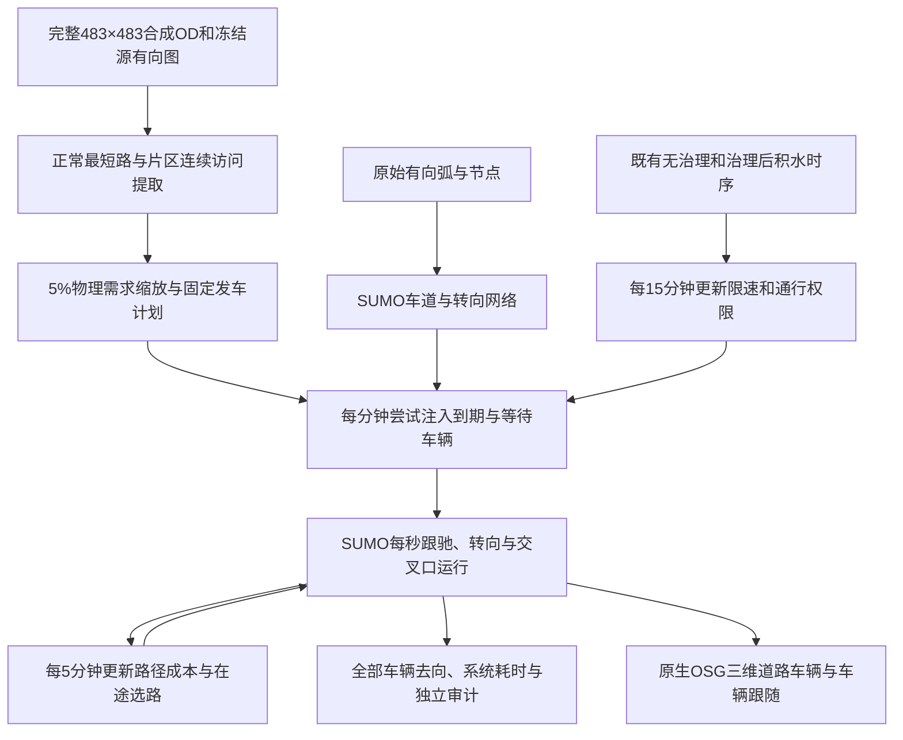
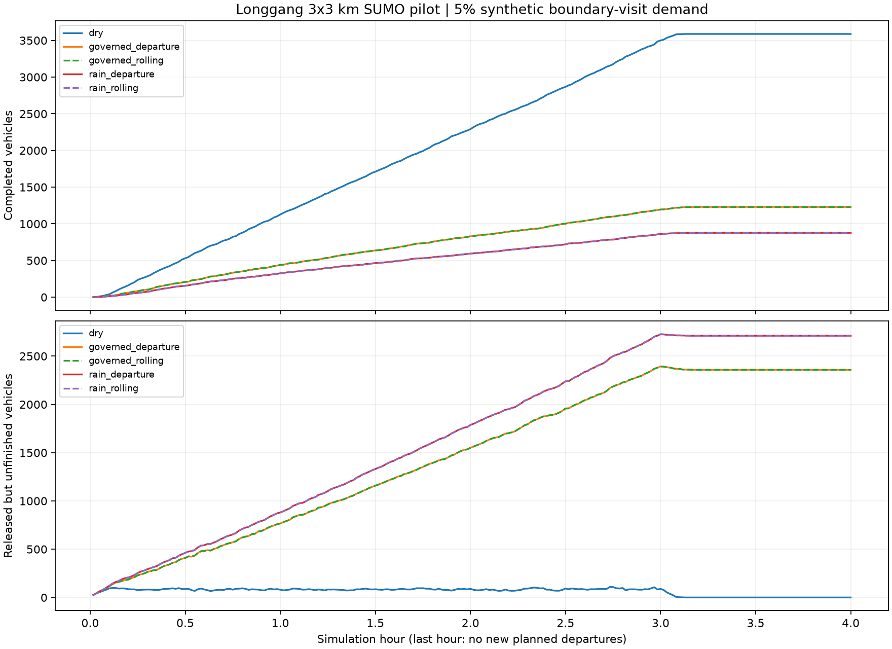
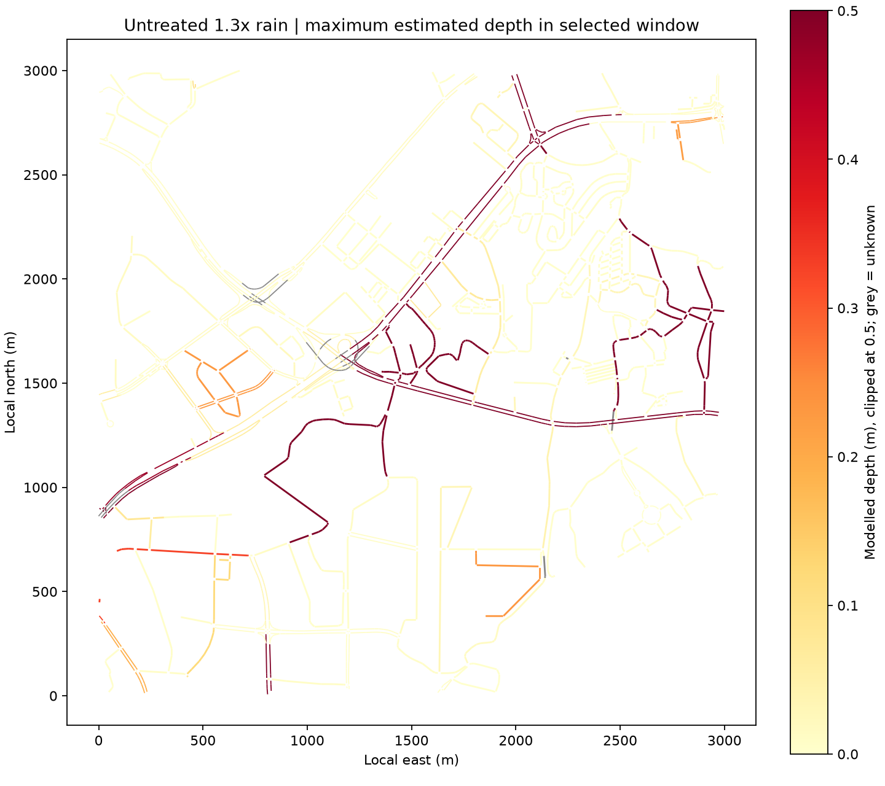
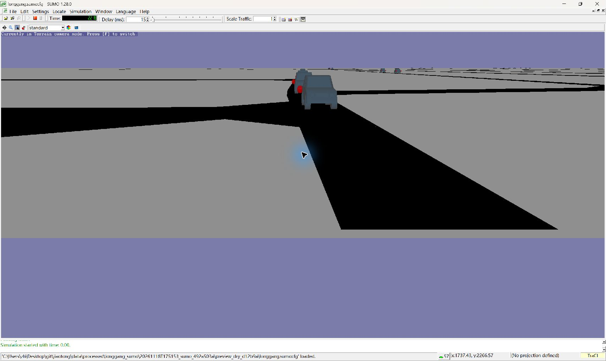

# 龙岗动态路径规划与 SUMO 3D 仿真：实现与操作步骤

更新：2026-11-19。当前完成的是**龙岗代表性片区的缩放需求微观试验**，采用滚动最短路径、TraCI积水控制和SUMO原生OSG三维显示。它不是全龙岗实测交通复现、动态用户均衡或已标定水动力仿真。

## 1. 当前已实现什么

| 功能 | 状态 |
| --- | --- |
| 冻结有向源弧转成SUMO车道网络 | 已运行，4,969条弧、2,938个节点；源弧ID逐一检查 |
| 从完整合成OD提取片区出入与穿越需求 | 已运行；正常最短路径边界访问法 |
| 同一随机计划比较不同方案 | 已运行，固定3,588辆车 |
| 水深控制限速、封路及退水重开 | 已接入既有1.3倍降雨、无治理和mask9治理水深 |
| 出发选路及在途滚动改道 | 已实现；本次真实片区实际改道次数均为0 |
| 在途改道功能验证 | 独立合成菱形路网已触发改道并完成行程 |
| 三维道路和车辆 | 已在OSG窗口观察并保存实际截图 |
| 实测车道、信号和跟驰标定 | 尚未完成 |
| 建筑、真实道路高程、动态三维水面 | 尚未接入 |

本轮主运行：`data/processed/longgang_sumo/20261118T175153_sumo_492a503a`。精简证据：[validation/longgang_sumo](validation/longgang_sumo/)。更早的首轮因重复路径查询低效而中止保留，不能与该主运行拼接使用。

## 2. 总体计算流程



道路退化公式单独见[道路交通性能退化全过程](LONGGANG_ROAD_DEGRADATION_PROCESS.md)。本轮复用已有水深结果，没有重新求解降雨汇流或重新优化治理选址。

## 3. 第一步：选定片区并转换路网

以先前按积水暴露选出的S0（114.131662°E，22.610792°N）为中心，取投影坐标下3 km×3 km方框。选择依据在本轮交通结果产生前固定。保留两端节点均位于方框内的有效非自环源弧，跨越方框但两端都在外的长弧不裁剪加入；因此这是离散路网工作域，不是精确几何裁剪。

片区周边跨行政边界道路用于交通连接；研究目标仍为龙岗不含大鹏，不把整个方框称为全区行政范围。使用EPSG:32650并平移至局部坐标。

通过 `netconvert` 生成车道及交叉口连接，要求SUMO源边集合与选中的4,969条源弧完全一致。全部采用每方向一条有效车道、优先权交叉口；没有真实信号配时。车道连接由SUMO生成，不能等同经核实的真实转向限制。桥隧拓扑沿用此前推定图，不因三维显示而变成已认证拓扑。

## 4. 第二步：从完整OD生成片区车辆需求

不只选起终点都在片区内的OD。具体步骤为：

1. 读取完整483×483三时段合成矩阵，核对分区顺序及连接点。
2. 在源图收缩走廊上，对每个有效起点计算正常状态最短路径。平行弧按成本、稳定ID顺序选择。
3. 将每条相关OD路径展开回源弧，提取每次连续位于片区内的访问。
4. 进入、离开、穿越及区内道路访问都保留；同一原始行程出区后再次进入，作为两次独立边界访问，不能解释为两辆独立的全市车辆。
5. 得到18,912个边界访问条目，记录原始OD和访问编号。未接入、区内、源图不可达与不经过片区的需求保留在完整OD账本中，不伪造SUMO行程。
6. 正常源弧路径不满足SUMO车道连接时，在相同首末边间查找SUMO正常路径；若仍无路径则保留为无效计划。

每个15分钟条目的预计出发量为：

$$
\mu_{ij,k}=0.05\times q_{ij,k}\times0.25.
$$

使用种子42的Poisson抽样决定整数车辆数，区间内均匀抽取计划出发时刻。期望约3,635.62辆，实际3,588辆，正常路径全部有效。五组实验使用**完全相同**的发车计划。

这是5%需求下真实运行的整数车辆，不能乘20声称得到全需求拥堵效果。当前边界访问由无雨全域路径固定；未模拟车辆在片区外因暴雨改变进入位置，不能称为全市动态边界分配。

## 5. 第三步：固定时间窗与初始条件

以无治理1.3倍雨量下，片区源弧关闭数量首次达到最大值的端点为中心，选择4小时窗口。对应北京时间2023-09-10 10:00—14:00；前3小时安排出发，末1小时停止新增计划、继续处理已有车辆。

窗口峰值为12:00，694条源弧达到0.30 m关闭阈值。76条弧深度未知，在交通中假设正常。网络从空状态开始，不继承前106小时的积压队列；末小时停止新增需求是一项实验设置，不能据此判定自然交通已恢复。

## 6. 第四步：积水怎样影响微观车辆

每900秒采用该区间起点水深，按既有Pregnolato速度关系限制速度，达到0.30 m时禁止passenger进入。未知值保留未知语义，交通按正常状态处理。

TraCI接口主要包括 `edge.setMaxSpeed`、`edge.setDisallowed`、`simulation.findRoute` 和 `vehicle.setRoute`。速度先从km/h除以3.6转换为m/s。

已位于关闭道路上的车辆保持等待；前方直接下一条道路关闭且未成功改道时，车辆也在当前道路上暂停。每秒检查，条件解除后恢复SUMO自主控制。此为保守的危险道路等待策略，可能较真实驾驶员更早停车，不能当作已标定应急行为。没有删除受困车辆或用自动传送清除拥堵。

### 容量在SUMO中的实现边界

SUMO没有一个与宏观道路容量直接等价的通用设置。本轮以车辆车头时距参数 `tau` 作为容量退化的代理：

$$
\tau_{0,e}=\max\left(1,\frac{3600}{C_{0,e}}-\frac{7.5}{v_{0,e}/3.6}\right),
\qquad
\tau_e=\frac{\tau_{0,e}}{\max(0.2,f_{C,e})}.
$$

7.5 m来自5 m车长和2.5 m最小间距；该关系是运动学近似，不是容量校准。`tau` 随车辆当前道路及水深条件变化。低速、启动、交叉口和1秒离散共同影响真实模拟出流。

独立饱和单路段检查（primary、正常50 km/h、参考容量1600 veh/h，统计600—1200秒）结果：

| 水深 | 宏观参考容量veh/h | SUMO代理实际出流veh/h |
| ---: | ---: | ---: |
| 0 m | 1600 | 1338 |
| 0.10 m | 1200 | 1026 |
| 0.20 m | 800 | 426 |

因此不能声称已把宏观容量精确写入SUMO。后续应逐道路类别和水深标定微观行为或明确的服务控制，再进行实测交通验证。

## 7. 第五步：滚动动态路径规划

每300秒，以及每次900秒积水状态更新时，重算当前边成本。用当前车辆订阅得到的道路平均速度估计运行时间；与水深限制下自由运行时间取较大值，以0.5平滑。观测速率的下限设为0.5 m/s，都是研究参数。没有车辆且不再观测到拥堵时，估计逐步向自由运行时间回落。

只利用当前道路状态及当前车辆观测，不读取未来积水来提前避险。闭路由通行权限排除，不依赖一个很大的有限时间来假装封路。

待出发及外部等待车辆每60秒尝试寻找当前可通行路线；没有路线就继续等待。规划时刻与计划出发存在最多约60秒调度差，计入起点等待。

滚动组中的在途车辆，到非内部交叉口边时比较当前剩余路线和新最短路线：

$$
J_{old}-J_{new}>\max(60\ \mathrm{s},0.10J_{old}).
$$

达到阈值才一般改道；旧路线上有关闭边时，若存在开放替代路线则强制更新。处于关闭道路上的车辆先等待，不允许绕过危险状态直接“跳”到其他道路。相同成本状态的查询按首末边缓存，状态更新时清空缓存。

这是**滚动当前成本最短路决策**，不是Bellman时空动态规划或动态用户均衡。若后续加入预测，可另外建立含等待弧的时间展开网络；完全已知未来积水应只作理想信息对照。

## 8. 第六步：对比五组情景

| 情景 | 水深 | 在途滚动改道 | 已到达 | 时窗末未完成 |
| --- | --- | --- | ---: | ---: |
| dry | 无雨 | 否 | 3588 | 0 |
| rain_departure | 无治理1.3倍雨量 | 否 | 877 | 2711 |
| rain_rolling | 无治理1.3倍雨量 | 是 | 877 | 2711 |
| governed_departure | mask9治理后1.3倍雨量 | 否 | 1230 | 2358 |
| governed_rolling | mask9治理后1.3倍雨量 | 是 | 1230 | 2358 |

五组都允许待发车辆按当前状态选路；“否”只表示车辆出发后不再次选路。治理mask9来自此前四候选试验，本轮未用SUMO重新优化。

滚动组分别尝试519和870次在途路线查询，实际路线修改均为0；因此本片区没有观察到额外滚动改道收益。暴雨组2,706辆仍在外部等待，5辆在网；治理后2,352辆外部等待、6辆在网。大量需求受端点或整体连通阻断，不能用改道凭空补足路径。结果相同也不能单独证明所有交通情形下改道无效。

另有独立合成菱形路网：10秒关闭b边，将行驶中车辆路线从 `a b b2 d` 改为 `a c c2 d`，车辆到达且无自动传送。该试验验证TraCI改道功能，不算龙岗收益。

## 9. 第七步：输出、车辆守恒与结果解释

逐秒检查注入车辆：

$$
N_{injected}=N_{arrived}+N_{running}+N_{SUMO\ pending}.
$$

时窗末完整计划分为无效计划、外部等待、SUMO内等待发车、在网、已到达五类。逐分钟序列还核对到期有效需求等于累计到达加所有未完成需求。五组车辆守恒误差均为0，自动传送0、碰撞车辆事件0。

系统耗时包含计划出发后外部等待、SUMO发车等待和在网时间，用1秒右端点累计；未完成及无效计划额外计7200秒惩罚。独立审计利用完整计划和tripinfo时间戳重放全部五组积分，说明时间步记账一致；1秒端点约定不等于连续时间精确积分。

已完成车辆平均行程时间会受“哪些车能够完成”的选择影响。不能因为暴雨组完成者平均时间更短，就判断暴雨改善了交通。必须同时报告完成量、外部等待和未完成惩罚。

实际曲线与道路暴露：





## 10. 第八步：运行及查看3D

从项目根目录运行，使用独立环境：

```powershell
# 新建运行目录，执行准备和五组仿真
.\.conda-env\python.exe scripts/run_longgang_sumo.py

# 审计；首次会执行单路段出流检查和合成改道功能检查
.\.conda-env\python.exe scripts/audit_longgang_sumo.py <新运行目录>

# 对已有运行重复核验时保留原出流试验，可用 --no-probe
.\.conda-env\python.exe scripts/audit_longgang_sumo.py <已有运行目录> --no-probe

# 用实际控制器重跑并显示3D；dry可换为rain_rolling或governed_rolling
.\.conda-env\python.exe scripts/view_longgang_sumo.py data/processed/longgang_sumo/20261118T175153_sumo_492a503a --scenario dry
```

查看器先核对输入SHA，再加载主运行归档的控制器，三维运行写入独立preview目录，不覆盖五组结果。仿真300秒后跟随一辆实际车辆。GUI内可使用工具栏“Recenter View”和鼠标调整观察位置。当前OSG对TraCI缩放请求的反馈与二维视图不同：请求1500仍返回100，不能据此声称该缩放倍率已生效；实际近景由车辆跟随和人工视角核验确认。

直接打开 `longgang.sumocfg` 只有网络及车型，无法还原由Python注入的车辆与封路控制；应使用上述查看器。窗口结束后若出现SUMO结束提示，关闭该提示即可。3D只负责显示，不参与水深计算。



当前三维道路为平面z=0，车辆使用原生模型；没有真实建筑与高程，也没有三维水流。窗口曾输出Arial字体加载提示，但道路及车辆显示已实际核验。不得用该画面代表真实城市三维重建。

## 11. 代码位置与后续工作

| 环节 | 文件 |
| --- | --- |
| 参数 | [longgang_sumo.yaml](../configs/longgang_sumo.yaml) |
| OD边界访问与路线判断 | [sumo_dynamic.py](../src/uftr/sumo_dynamic.py) |
| 路网转换、五组仿真、TraCI控制 | [run_longgang_sumo.py](../scripts/run_longgang_sumo.py) |
| 独立审计、出流及改道试验、图表 | [audit_longgang_sumo.py](../scripts/audit_longgang_sumo.py) |
| 归档控制器的三维查看入口 | [view_longgang_sumo.py](../scripts/view_longgang_sumo.py) |
| 数值与网络单元测试 | [test_sumo_dynamic.py](../tests/test_sumo_dynamic.py) |

本轮完整测试171项通过，pip check无冲突；六项新增测试为桌面模型的数值与网络测试。独立审计核对源边、计划路径、168,946个道路水深值及五组车辆账本。这些说明软件及数值一致性，不替代实测标定。

下一阶段优先补充真实车道、转向和信号资料，校准容量代理；再扩大需求比例、增加随机种子、改变片区与封路阈值，检查边界外绕行与排队回溢影响。在这些检查前，当前结果只作为方法接入试验，不用于全区工程收益预测。
