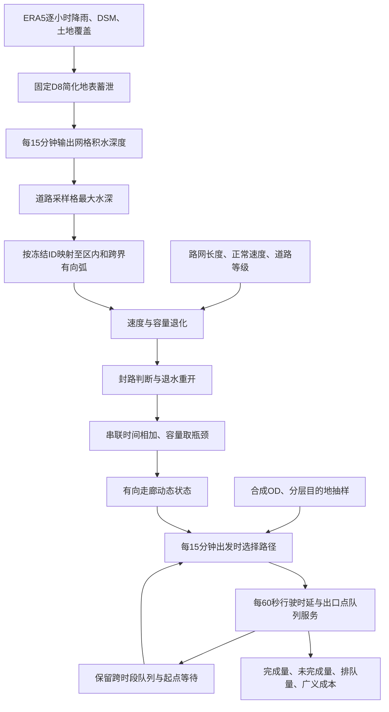

# 龙岗道路交通性能退化模型：全过程说明

更新日期：2026-11-19。适用范围：当前龙岗研究区，不含大鹏。

当前采用的是**水深驱动的速度退化＋分道路等级容量退化＋阈值封路＋跨时段比例服务点队列**。它把估计积水转换成道路通行条件，再结合合成OD计算车辆行驶、绕行、排队和未完成需求。

本文对应 `configs/longgang_adaptive.yaml` 与当前 `src/uftr/adaptive*.py`，引用已验收运行 `20261118T165311_adaptive_4adc99a6`。这是未实测标定的研究原型，输出不等于真实龙岗交通状态。历史南山模块的BPR和独立时片用户均衡，不代表本版本的交通计算方法。

## 1. 全过程流程图



道路退化描述“积水后能开多快、每小时最多通过多少车”；交通加载描述“给定需求后有多少车行驶、等待或完成”。两者通过动态道路状态连接。

## 2. 第一步：准备输入，统一单位

| 输入或符号 | 单位 | 当前来源及含义 |
| --- | --- | --- |
| 降雨 | mm/h | ERA5再分析，经Open-Meteo获取；不是站点实测 |
| 地形、土地覆盖 | m、类别比例 | DSM及ESA WorldCover 2021；不包含真实完整排水管网 |
| 网格水深、道路水深 (h) | m | 简化地表蓄泄估计 |
| 道路长度 (L_e) | m | 推定有向路网 |
| 正常速度 (v_{0,e}) | km/h | 路网标签或道路等级默认估计，非实测流速 |
| 正常容量 (C_{0,e}) | veh/h/方向 | 配置假设，每方向一条有效车道 |
| 出行需求 (q_{ij}) | veh/h | 龙岗483×483合成OD，非官方实测OD |
| 运行时间 (T)、交通步长 Δt | s | 内部统一以秒计算 |
| 排队量 (Q) | veh | 连续流体车辆量，可以含小数 |

水文计算内部步长180秒，150 m网格共66,920格，每900秒输出一次；120小时共481个状态端点。交通计算以60秒为一步，同一15分钟区间内使用区间起点道路状态，最后一个端点用于界定时窗末端。

## 3. 第二步：从降雨得到积水深度

当前上游采用B方案的简化地表汇流：在固定D8方向和DSM洼地储量基础上，逐步执行“加雨→受限损失→同时向下游转移”。土地覆盖给出空间变化的综合损失能力：

$$
c_i=2f_{built,i}+8f_{vegetation,i}+4f_{bare,i}+0f_{water,i}
\quad(\mathrm{mm/h}).
$$

系数2、8、4、0均为项目假设，合并表示入渗和未解析排水。土地覆盖数据真实存在，不代表损失系数已实测。分别使用0.7、1.0、1.3倍降雨进行情景比较。

这里的水深是模型储水深度，不是经过路面积水传感器标定的实测深度。本版本不是SWMM与二维水动力耦合模型。上游完整步骤见[分区积水方法](LONGGANG_ADAPTIVE_MODEL.md)和[ERA5地形汇流说明](LONGGANG_ERA5_SURFACE_MODEL.md)。

## 4. 第三步：将网格水深映射到道路

冻结的道路采样涉及33,597个地面采样位置、8,530个网格。对每条地面源线 (f)，取有效采样网格集合 (S_f) 中最大水深：

$$
h_f(t)=\max_{i\in S_f}h_i(t).
$$

这是用最深采样位置代表整条源线的保守暴露近似；不表示沿整条道路都存在同样水深，也未解析车道横断面与局部路缘高度。

具体映射顺序：

1. 保留6,848条地面源线的估计深度；952条桥隧、非零layer等源线保持未知值NaN。
2. 读取冻结的86,807条区内及跨界有向弧清单。
3. 按 `edge_id` 对齐，并核对 `u/v/key/source_feature_position`。
4. 只对这些清单内的有向弧应用对应源线水深。同一源线在区外的其他弧不继承区内深度。
5. 全深圳451,801条推定有向弧保留用于跨区路径，方向、平行边和断连不因水深关联而改写；其拓扑尚未认证。

**未知值处理：**数据层仍保留NaN；交通情景对未知桥隧及积水覆盖外道路采用“假设正常”。这不构成“已观测无积水”的证据。

## 5. 第四步：确定正常速度和正常容量

无积水时，沿用每条有向弧的正常速度 (v_{0,e})。容量及退化系数如下：

| 道路类别 | 正常容量 (C_{0,e})（veh/h/方向） | 容量退化系数 (a_e) |
| --- | ---: | ---: |
| motorway | 2000 | 0.65 |
| trunk | 1800 | 0.70 |
| primary | 1600 | 0.75 |
| secondary | 1400 | 0.80 |
| tertiary | 1200 | 0.85 |
| residential | 800 | 0.90 |
| living_street | 500 | 0.90 |
| service | 500 | 0.90 |
| 其他、无法匹配 | 800 | 0.90 |

以 `_link` 结尾的连接道路去除该后缀后，继承对应主类别参数。这些容量假设每方向一条有效车道，没有按真实车道数、信号配时和实测饱和流量标定。

容量是服务上限，不是实际流量。例如容量为1600 veh/h，并不意味着每小时一定有1600辆车通过。

## 6. 第五步：水深驱动速度退化

采用Pregnolato等（2017）的水深—速度关系，项目留存PDF第7页Eq.4：

$$
w=1000h,
\qquad
v_{lim}(w)=0.0009w^2-0.5529w+86.9448.
$$

其中 (h) 为米，(w) 为毫米，(v_{lim}) 为km/h。来源：[Transportation Research Part D，DOI:10.1016/j.trd.2017.06.020](https://doi.org/10.1016/j.trd.2017.06.020)。

实际用于模型的速度为：

$$
v_e(h)=
\begin{cases}
v_{0,e}, & h=0,\\
\min\{v_{0,e},\max[0,v_{lim}(1000h)]\}, & 0<h<h_c,\\
0, & h\ge h_c.
\end{cases}
$$

基准关闭阈值 (h_c=0.30\,m)。零水深单独保持正常速度，避免将无雨高速道路压至多项式截距86.9448 km/h；有水时速度不超过正常速度；到达阈值即关闭，不把多项式外推到更深水位继续行车。

文献提供水深—速度经验关系；上述零水深分支、正常速度上限及关闭规则是项目接入方式，不能全部称为论文原公式或官方车辆安全标准。

## 7. 第六步：水深驱动容量退化

独立于速度函数，容量按下式计算：

$$
C_e(h)=
\begin{cases}
C_{0,e}\max\left(0.20,1-a_e\dfrac{h}{h_c}\right), & 0\le h<h_c,\\
0, & h\ge h_c.
\end{cases}
$$

积水增大时，开放道路的有效服务能力下降；关闭后容量直接归零。0.20是开放阶段容量比例的下限，不表示关闭后还能保留20%容量。

**本节容量函数、分类系数、容量下限及0.30 m阈值全部是项目假设，不是Pregnolato论文的容量公式。** 当前系数下，某些类别会在达到下限前先触发关闭，因此下限不一定实际生效。

已有附加敏感性试验把 (h_c) 改为0.20 m；此时容量函数分母也同步改为0.20 m，不能只改关闭判断。

## 8. 第七步：判断关闭、退水与重开

| 道路水深状态 | 模型处理 |
| --- | --- |
| (h=0) | 正常速度、正常容量 |
| (0<h<h_c) | 同时计算速度限制和容量退化 |
| (h\ge h_c) | 速度0、容量0，路径选择排除，队列出口不服务 |
| 退水至 (h<h_c) | 在下一个采用该状态的交通区间恢复相应速度和容量 |
| NaN或覆盖外 | 保留未知语义，交通采用假设正常 |

阈值处存在突变，当前未加入封路执行时延、排障检查、重开延迟或滞回。道路重开不会清空此前队列；积压车辆仍需按恢复后的容量逐步通过。

车辆在某条走廊内行驶时若走廊随后关闭，当前实现保留已安排的行驶时延，到达出口后因容量0而等待。它不模拟车辆在积水中抛锚、倒车或救援过程。

## 9. 第八步：转换为运行时间，并聚合有向走廊

开放道路的运行时间：

$$
T^{run}_e(h)=\frac{3.6L_e}{v_e(h)}\quad(\mathrm{s}).
$$

长度单位为米、速度单位为km/h，因此需要3.6换算。这里只表示给定水深下的行驶时间，排队等待另算。

为降低计算量，将连续无分叉、非OD连接点的源弧收缩成有向走廊 (g)，保存完整源弧序列：

$$
T_g=\sum_{e\in g}T^{run}_e,
\qquad C_g=\min_{e\in g}C_e.
$$

时间按串联相加，容量取瓶颈；任一内部弧关闭，整条走廊容量为0。451,801条源弧收缩为97,030条走廊，走廊内部排队位置未逐弧解析。既有正常状态最短路独立对照的最大成本误差为 (4.09\times10^{-12}) 秒。

**代码中的关闭时间占位：**`corridor_states` 为保持时延数组有限，对关闭源弧暂用正常速度计算一个有限时间占位值；关闭仍由容量0控制，选路排除该走廊，出口服务量也为0。不能把该有限字段解释成关闭道路仍可通行，也不能声称当前全部关闭时间字段都保存为无穷大。

## 10. 第九步：加载OD，在出发时选择路径

原483×483合成OD用于完整需求记账。交通加载对有效接入的每个起点做2层目的地带权抽样，保留每个起点、每个时段的可加载总量；另以4层检查抽样敏感性。保持起点总量不代表完整保留每个目的地的需求或每条道路的流量。

三类合成时段矩阵必须成比例；代码会拒绝不满足此条件的输入。将相同24小时需求重复5天，总计约11,193,627.796车次，不能解释成2023年真实逐日需求。区内需求及未接入需求分别保留记账。

候选路径库来自三种构造状态的最短路径并去重：无雨、1.0倍降雨各道路各自峰值、1.3倍降雨各道路各自峰值。各道路峰值可能出现在不同时刻，峰值组合只用来生成替代路径，不代表同时发生的洪水状态。

每15分钟，将新增需求和此前起点等待需求合并，在当前开放的库内路径中选择成本最低者：

$$
J_p(t)=\sum_{g\in p}\left[T_g(t)+\lambda\frac{3600Q_g(t)}{C_g(t)}\right],
\qquad\lambda=1.
$$

(Q_g) 是当前走廊出口点队列总量，(3600Q_g/C_g) 是按当前容量估算的排队秒数。任一走廊容量0，该路径不可选；相同成本按路径库顺序稳定选取。

无可用库内路径时，需求留在起点等待，下一次选路时重试。有限路径库可能遗漏真实可行绕行路线。车辆出发后沿已选路径行驶，途中不重新规划；该过程没有迭代到动态用户均衡。

## 11. 第十步：跨时段点队列计算拥堵

每个60秒交通步依次进行：

1. 将到达预约行驶时刻的车辆移入走廊出口队列。
2. 若到15分钟边界，释放新增需求并为起点等待车辆选择路径。
3. 检查每类路径车辆的下一走廊是否开放；下游关闭的车辆继续留在当前出口队列。
4. 对可服务的车辆，按其排队量比例共享当前走廊容量。
5. 已通过末段的车辆计为完成；其他车辆进入下一走廊行驶时延。
6. 保留起点等待、道路排队和行驶中车辆，进入下一步。

任一步走廊出口总服务量满足：

$$
s_g\le C_g\frac{\Delta t}{3600}.
$$

例如容量800 veh/h、步长60秒时，最多服务13.3333 veh；小数表示连续流体近似。按进入走廊时的状态安排行驶步数：

$$
n_g=\max\left(1,\left\lceil\frac{T_g}{\Delta t}\right\rceil\right).
$$

第一阶段额外加入起点和终点连接距离合计的接入时间，接入速度假设为20 km/h。向上取整会带来时间离散误差，既有运行另以30秒步长检查敏感性。

当前采用比例服务，不保证严格FIFO；点队列没有有限道路储存约束，不模拟物理回溢、车道占用或信号控制。下游关闭仅阻止对应路径车辆转入，不会在几何空间中形成车队并阻挡其他转向。

**为什么没有再加BPR？**当前拥堵来自服务容量约束和跨时段队列积累，代码没有再使用 (T=T_0[1+\alpha(q/C)^\beta]) 放大时间。把历史BPR直接叠加会改变模型含义，并可能重复计入拥堵。

每步检查车辆守恒：

$$
N_{released}=N_{completed}+N_{transit}+N_{queue}+N_{origin}.
$$

该式针对进入点队列系统的需求；未接入需求与区内需求在外部独立记账。

## 12. 一个完整数值例子

取一条长1000 m的primary道路，正常速度50 km/h，正常容量1600 veh/h，(a=0.75)，关闭阈值0.30 m。由上述公式得到：

| 水深（m） | 模型速度（km/h） | 容量（veh/h） | 仅行驶时间（s） |
| ---: | ---: | ---: | ---: |
| 0.00 | 50.0000 | 1600 | 72.00 |
| 0.05 | 50.0000 | 1400 | 72.00 |
| 0.10 | 40.6548 | 1200 | 88.55 |
| 0.15 | 24.2598 | 1000 | 148.39 |
| 0.20 | 12.3648 | 800 | 291.15 |
| 0.25 | 4.9698 | 600 | 724.38 |
| 0.30 | 0 | 0 | 关闭，不可通行 |

0.05 m时速度仍受正常速度50 km/h上限约束，容量已下降。0.20 m时，假设道路同时为一条走廊、出口队列80 veh，则选路估计的排队时间为 (3600\times80/800=360$ 秒，路径该段成本约651.15秒。实际交通内部将291.15秒行驶时延取整为5个60秒步；后续实际等待还取决于容量变化、竞争车辆和下游状态，因此选路估计不是最终实现时间。

若随后水深达到0.30 m，容量为0，已有车辆不会消失；退水到0.20 m并采用新状态后，最多按每60秒13.3333 veh逐步服务符合下游开放条件的车辆。

## 13. 输出指标怎样解释

道路层输出或派生水深、速度、容量、关闭状态及运行时间；网络交通层记录累计释放、完成、行驶中、道路排队、起点等待、时窗末未完成量与车辆守恒误差。

有限时窗广义成本按以下构成：

$$
G=\sum_k N_{remaining,k}\Delta t
+7200N_{unfinished}
+7200N_{unlinked}
+300N_{intrazonal}.
$$

(N_{remaining,k}) 为步末仍在行驶、排队或起点等待的可加载车辆；积分采用右端点求和。终端未完成惩罚7200秒、未接入惩罚7200秒及区内时间300秒均为项目假设。未完成车辆仍未完成，惩罚不代表它们真实在两小时后到达。

该广义成本不是“已到达车辆平均旅行时间”，也不能直接换算为官方拥堵指数。当前无雨参考本身已存在约523万时窗末未完成车次，说明需求、容量和加载近似下基础系统已过饱和；雨天比较必须同时披露这一基线，不能据此推断真实龙岗拥堵。

## 14. 如何用于治理比较

用户已同意相对成本和最多3处治理。治理改变局部假设损失能力后，必须重新执行“积水→道路退化→选路与点队列”，再比较相同OD、抽样方式和交通步长下的成本与未完成量。

当前NSGA-II是此模型的下游应用：只在4处候选中比较最多3处的方案，并独立穷举全部15个可行组合。治理结论受积水参数、道路容量和目的地抽样影响；不能将小规模试验称作全区工程最优方案。步骤见[分区积水与治理方法](LONGGANG_ADAPTIVE_MODEL.md)，结果见[阶段报告](PHASE_LONGGANG_ADAPTIVE_REPORT.md)。

## 15. 代码对应、核验与重现入口

| 环节 | 文件与函数 |
| --- | --- |
| 网格积水 | [adaptive.py](../src/uftr/adaptive.py)：`surface_route` |
| 水深到速度、容量 | [adaptive.py](../src/uftr/adaptive.py)：`road_factors` |
| OD分层抽样 | [adaptive.py](../src/uftr/adaptive.py)：`sample_od` |
| 跨时段交通加载 | [adaptive.py](../src/uftr/adaptive.py)：`point_queue` |
| 走廊收缩、状态聚合、路径库 | [adaptive_network.py](../src/uftr/adaptive_network.py)：`contract`、`corridor_states`、`route_library`、`pack_paths` |
| 水深最大值聚合、弧ID限制、总账与运行组织 | [run_longgang_adaptive.py](../scripts/run_longgang_adaptive.py) |
| 参数 | [longgang_adaptive.yaml](../configs/longgang_adaptive.yaml) |
| 既有核验记录 | [validation/longgang_adaptive](validation/longgang_adaptive/) |

上述已验收运行的记录包括165项测试、pip check、19,722,240个道路水深值独立重放、52份交通账本及全部15个治理组合核对。这些是既有模型验收记录；本次仅编写说明并复算本节数值例子，没有重跑仿真或完整测试。数值守恒与代码一致性核验不等于真实灾情和车流标定。

如需重新计算，在项目根目录使用独立环境，以下占位路径需替换成实际目录：

```powershell
.\.conda-env\python.exe scripts/run_longgang_adaptive.py --landcover <土地覆盖运行目录>
.\.conda-env\python.exe scripts/audit_longgang_adaptive.py <新运行目录>
```

每次新计算保留独立run_id、配置、源码及输入SHA；不覆盖历史manifest。若更改模型，按项目规范执行pytest、pip check及相应数值审计。当前最需要实测补充的是路面积水时序、真实车道与容量、分时段交通流和OD，用于标定水深、退化系数和加载结果。
