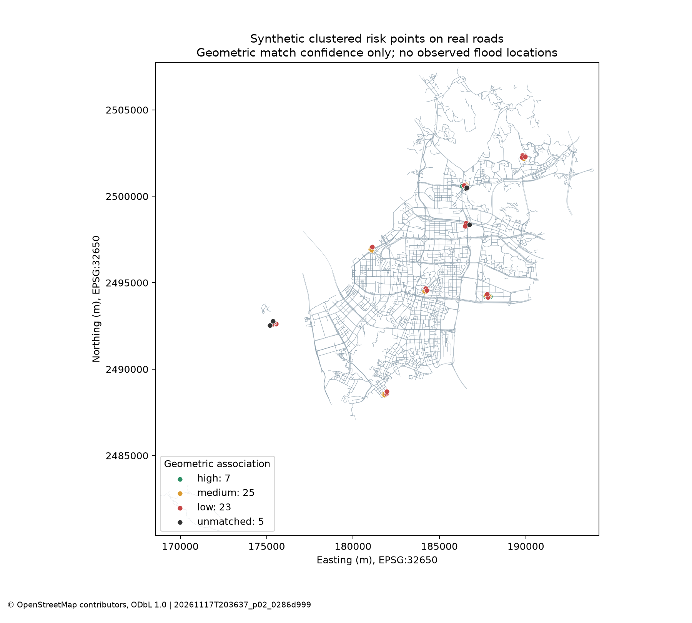
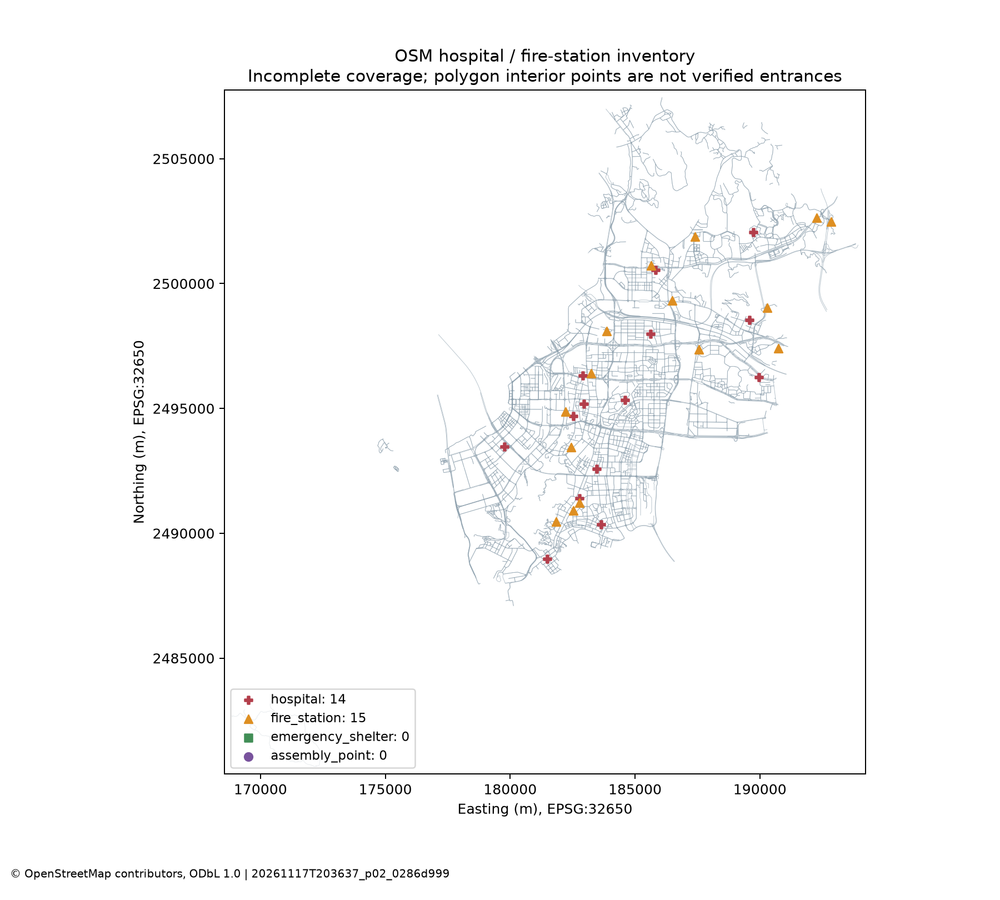
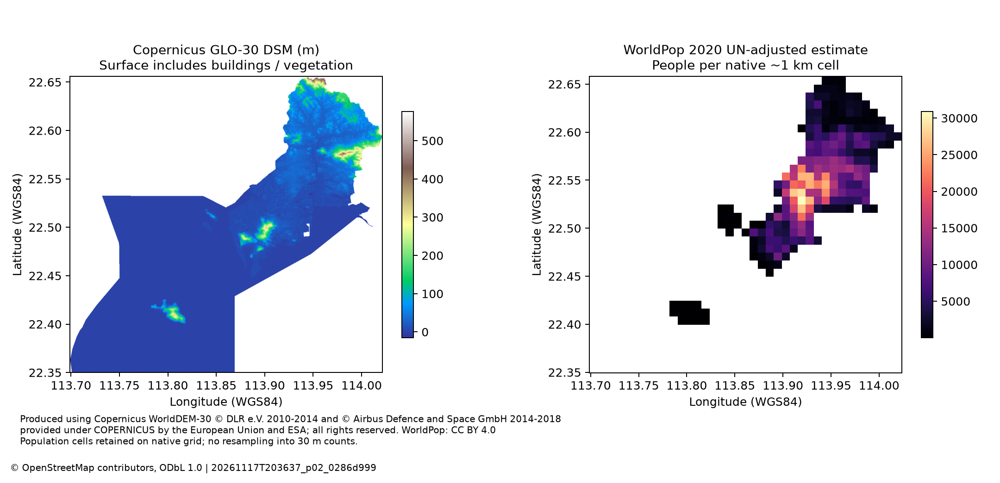
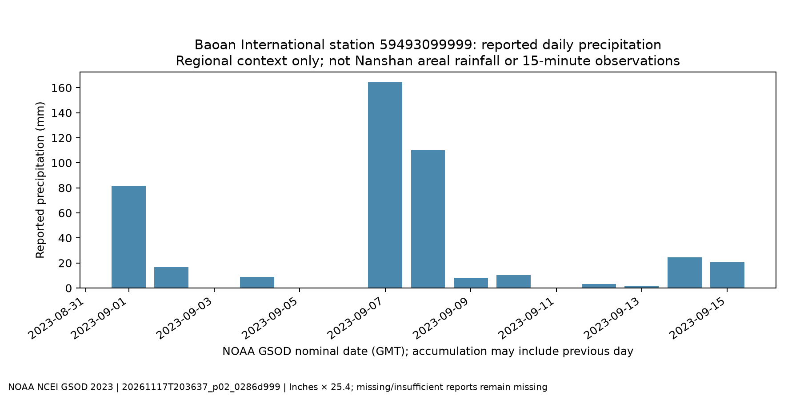

# Phase 02 验收报告：空间数据与合成风险输入

2026-11-17完成，状态为 **passed_with_explicit_data_gaps**。本阶段实际下载并处理地形、人口、逐日雨量，复用原始OSM提取设施；官方历史积水坐标及水深未取得，按任务书数据缺失条款生成明确标注的合成风险点。没有开展历史灾害重建、内涝时序、交通分配、韧性或治理实验。Phase 03尚未开始。

## 可复现运行与验收

- 最终运行：`20261117T203637_p02_0286d999`，2026-11-17 20:36:37 +08:00开始，47.4027秒。
- 实现提交：`878e4671298cb208349c29d81d5b2d70d32868a6`，当次`dirty=false`，种子42，workers=1。
- 对照运行：`20261117T203230_p02_9be1082c`保留，首次运行时文档脚本存在Git换行/stat脏标志；未冒充干净验收。最终离线重放两栅格、设施、雨量、道路匹配、合成点六项数据输出逐字节一致。
- 全部77项pytest通过，0失败；35条rasterio/affine矩阵运算未来弃用警告，未屏蔽。`pip check`无冲突。历史Phase 00为37项、Phase 01为62项，保持原验收口径。
- 独立归档审计：4张图片、215项输入、74个当次索引链接通过。空间审计独立核验233个人口原生像元、365条雨量和74条选中有向边距离，重放一致。
- 修复历史输入审计：已提交源文件后续改变时，按原运行Git提交的精确blob核验；原始/处理等未跟踪不可变输入仍须本地字节一致。Phase 01旧验收重审通过，3项历史源文件由Git验证。
- 四张最终PNG已分别查看，无裁切或文字重叠。两版文档同步结果以`docs/deliverables/delivery_manifest.json`为准。

```powershell
& .\.conda-env\python.exe -m pytest --junitxml=docs/validation/phase02/pytest-final.xml
& .\.conda-env\python.exe -m pip check
& .\.conda-env\python.exe -m uftr.cli run --phase 02 --offline-source data/raw/phase02/20261117_source_acquisition
& .\.conda-env\python.exe scripts/audit_run.py --run-id 20261117T203637_p02_0286d999 --output docs/validation/phase02/run_audit.json
& .\.conda-env\python.exe scripts/audit_spatial.py --run-id 20261117T203637_p02_0286d999 --compare-run 20261117T203230_p02_9be1082c --output docs/validation/phase02/spatial_audit.json
& .\.conda-env\python.exe -m uftr.cli history --phase 02
```

在线重新获取可执行`run --phase 02`，按配置URL写入新的下载快照，可能受网络或源站变化影响。本地离线重放需要本机raw Phase 02、原始OSM Phase 01与已验收Phase 01路网，全部通过清单指纹和输入合同校验；克隆Git仓库本身不包含这些大型数据。

## 实际来源、许可与获取边界

| 数据 | 实际获取与质量 | 使用边界 |
| --- | --- | --- |
| Copernicus GLO-30 | AWS 2021发布，N22 E113/E114两块COG，36,641,041与25,030,462字节；EPSG:4326，约30m，EGM2008米 | DSM含建筑/植被，TanDEM-X 2011—2015及更早补洞，不是裸地排水DTM |
| WorldPop | 2020 CHN aggregated UN-adjusted约1km人数栅格，49,445,858字节；CC BY 4.0 | 每原生像元的模型估计人数，不是密度或2023/2026普查，不直接等于交通需求 |
| NOAA NCEI GSOD | 宝安国际机场站59493099999，2023年365条日记录，355条有效；G355条、空标志7条、I3条 | 站位22.639258N/113.810664E位于南山以外；GMT名义日期且累计可含前一日，不作为南山面雨量或15分钟输入 |
| OSM设施 | 复用Phase 01原始未按机动车道路筛选的XML，得到医院14、消防站15 | 标签及覆盖不完整，保留OSM ID、名称和位置方法；面内点不是核验入口 |
| 官方积水/监测/避难所/气象 | 深圳开放平台公开目录可访问，页面使用的普通元数据请求返回HTTP403；页面提示下载需登录和实名认证 | 仅取得目录与失败响应，未取得可用历史点/水深或完整避难名录，未绕过访问条件 |

主要URL：

- Copernicus：<https://copernicus-dem-30m.s3.amazonaws.com/readme.html>；两块下载URL、许可页与访问时间完整保存在`configs/phase02.yaml`及来源清单。
- WorldPop：<https://data.worldpop.org/GIS/Population/Global_2000_2020_1km_UNadj/2020/CHN/chn_ppp_2020_1km_Aggregated_UNadj.tif>。
- NOAA：<https://www.ncei.noaa.gov/data/global-summary-of-the-day/access/2023/59493099999.csv>；说明<https://www.ncei.noaa.gov/data/global-summary-of-the-day/doc/readme.txt>。
- 官方积水目录：<https://opendata.sz.gov.cn/data/dataSet/toDataDetails/29200_04003891>；监测`29200_04003929`，避难所`29200_04003846`，气象`29200_00900273`。
- OSM：© OpenStreetMap contributors，ODbL 1.0，<https://www.openstreetmap.org/copyright>。

Copernicus修改后产品署名：**Produced using Copernicus WorldDEM-30 © DLR e.V. 2010-2014 and © Airbus Defence and Space GmbH 2014-2018 provided under COPERNICUS by the European Union and ESA; all rights reserved**。

失败与未采纳来源也保留：GHCN/Meteostat尝试404；NOAA hourly部分URL虽200但返回HTML，未纳入观测；HKO参数错误；水务网站SSL BAD_ECPOINT。WorldPop尝试的REST元数据端点404，另存有效100m基础产品方法元数据时明确只作方法背景，未冒充本次1km文件的元数据。探查记录的截断字节数不是完整下载大小，以封存清单为准。

## 清洗、栅格与匹配方法

所有输出位置WGS84，距离在EPSG:32650计算。使用Phase 01南山研究多边形（OSM行政范围与配置bbox交集，含海域/岛屿，不是官方陆地边界）。栅格裁剪窗口对齐原生格网，以像元中心落入多边形保留，NoData=-9999，不重采样人口，不把每像元人数当人口密度。边界和海岸有部分像元误差。

| 处理结果 | 实际数值 |
| --- | --- |
| DSM有效像元 | 563,281；最小−15.50722m，最大576.77734m。负值原样保留，但不用于风险种子 |
| 人口有效原生像元 | 233；人数合计1,540,614.3657，是按本研究边界规则裁剪的模型估计，不是官方南山人口 |
| 2023-09-07/08宝安逐日报告 | 164.338 / 110.236 mm，原6.47 / 4.34英寸×25.4，标志G；不解释为本地自然日雨量 |
| 观测积水点/水深 | 0 / 0，含义为未取得数据，不代表没有发生积水 |
| 合成点 | 60，8簇，种子42，聚集标准差90m，DSM上限40m，权重尺度10m |
| 几何置信度 | 高7、中25、低23、未匹配5个点 |
| 道路候选 | 1,414行，其中122行桥/隧道/layer排除；74条选中有向边行，可包含同几何正反向 |

匹配先搜100m候选，保留所有候选的edge_id、米制距离、排除理由、歧义间隔和selected标志。桥、隧道、非零或复杂layer不按地面点直接选择。将规范化相同几何的正反向边作为一组，选中组最近距离须≤60m。高置信度需距离≤15m、次近不同几何距离差≥15m（或无第二候选），且非_link匝道；中置信度需距离≤40m、间隔≥5m（或无第二候选）；其余选中为低置信度。未选中的候选保持candidate_only，存在候选却无合格组的点也计未匹配。OSM层级标签本身可能不完整，因此这些只是几何关联置信度，不能声明道路实际受灾。

合成方法：在地面道路去重复几何中点采样DSM，保留0—40m，按exp(−z/10)抽取8簇中心，在EPSG:32650中以90m标准差高斯扰动，拒绝边界外、NoData和不合高程条件的位置，生成60点。观测日期和水深均为空。它是未来参数化情景的风险种子，不是历史积水、水动力风险概率或已计算受灾道路。

OSM POI去掉跨XML瓦片的相同ID重复，过滤无效/范围外要素。不同OSM ID的邻近点和入口没有证据时不强行合并。公交候车亭不算避难所，assembly point与指定emergency shelter分开，当前两类均无合格标签，不能据此认定现实没有避难设施。设施道路关联仅为候选，需后续核实入口。

## 文件与实际图片

原始快照：`data/raw/phase02/20261117_source_acquisition/`，完整来源/错误响应/许可/清单。处理：`data/processed/phase02/20261117T203637_p02_0286d999/`；合成：`data/synthetic/phase02/20261117T203637_p02_0286d999/`。两份flood_points分别为空的真实集合和60点synthetic集合，不能混用。

| 任务书输出 | 实际文件 |
| --- | --- |
| flood_points.geojson | processed同名空真实集合，synthetic同名60点，均有来源说明 |
| flood_road_mapping.csv | processed同名，逐行source_kind=synthetic，包含全部候选及选择标志 |
| rainfall_timeseries.csv | processed同名，365条含原始英寸、标志、有效性和位置 |
| elevation.tif / population.tif | `copernicus_dsm_30m.tif` / `population_2020_native_1km.tif`，显式命名产品、年份、精度 |
| emergency_poi.geojson | `facilities.geojson`，另有`facility_road_candidates.csv` |
| flood_risk_map.png | `results/runs/<run_id>/figures/synthetic_risk_map.png`，标题明确合成 |
| data_quality_report.md | 本报告与`docs/validation/phase02/data_quality_report.md`；机器可读版processed的`data_quality_report.json` |

四张最终图和小型输入/输出摘要已复制到`docs/validation/phase02/`纳入Git，大栅格和全部运行目录本机保留。打开`results/index.html`或CLI history可查询历史。验收副本清单见`acceptance_inventory.json`，不替代本机全量数据备份。









## 限制与下一阶段

本阶段依任务书缺失替代方案验收。资料跨年份、人口粗格网、OSM不完整和单站日雨量均限制结论，不支持2023深圳历史洪涝重建。尚无实测OD、内涝时序、交通流、韧性提升或最优治理结果。用户提供仓库后，已将实现、阶段验收、维护文档及小型图片正常推送至<https://github.com/zhzhzh666/jiaotong>，首次确认远端main=71e17a07a6e46219f88f5b9b4402f8abe4a4ba6f。保留仅含README的远端初始提交，未强制推送；原始论文、环境、大型raw/processed/results未纳入Git。

下一次继续实施Phase 03：1000m TAZ，人口与设施估计产生吸引，重力/IPF构建合成OD，明确边界需求、路网连接、不可达和人口年份差。本阶段结束停止，不提前实施。
